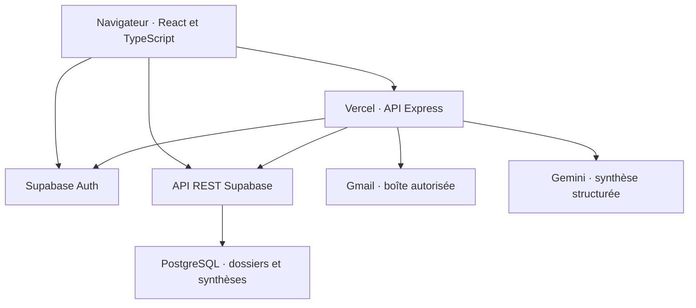

# Watchover · ClientCare

Watchover aide une équipe à suivre ses clients, à planifier ses relances et à retrouver le contexte des échanges. Olimline, une activité de téléphonie, sert de cas de démonstration.

## Ouvrir la démonstration

- [Site Watchover](https://client-care-rho.vercel.app/)
- [Site Olimline](https://client-care-rho.vercel.app/#/olimline)

L’administrateur et le coordinateur se connectent depuis le lien dédié à leur rôle. Pour inviter un coordinateur, l’administrateur ouvre **Accès de l’équipe** et génère une invitation pour son adresse e-mail. L’invitation expire après 24 heures et permet une seule activation.

## Démarrer en local

Avec Node.js 24, exécuter cette commande à la racine du dépôt.

```bash
npm ci
```

Créer un fichier `.env.local` à la racine avec l’URL et la clé publique du projet Supabase utilisé pour les tests.

```dotenv
VITE_SUPABASE_URL=https://votre-projet.supabase.co
VITE_SUPABASE_PUBLISHABLE_KEY=votre_cle_publique_supabase
```

```bash
npm run dev
```

Ouvrir l’adresse indiquée par Vite. Le serveur Vite lance l’interface. Pour tester le parcours Gmail complet, utiliser le déploiement Vercel relié à la boîte autorisée. La clé `GEMINI_API_KEY` se configure côté serveur dans Vercel. [Guide de configuration Gmail et Gemini](docs/gmail-analysis.md)

### Préparer une base Supabase de test

1. Dans le SQL Editor d’un projet Supabase de test vide, exécuter les scripts `01` à `06`, puis `08`, `12` à `16` et `18`, dans cet ordre. [Scripts SQL](supabase/pas-a-pas)
2. Créer et confirmer le compte de test dans Supabase Auth. Renseigner son nom et son adresse dans une copie de `09-administratrice.sql` et exécuter cette copie pour attribuer le rôle administrateur. [Script d’attribution du rôle](supabase/pas-a-pas/09-administratrice.sql)
3. Depuis **Accès de l’équipe**, créer une invitation pour un second compte de test avec le rôle **Coordinateur**. Ouvrir le lien avec ce compte et accepter l’invitation.
4. Créer une fiche avec **Nouvelle fiche**. Pour la séquence Gmail, préparer une adresse de test dont les échanges sont déjà présents dans la boîte Gmail autorisée.

## Architecture



- **Connexion et droits.** Supabase Auth établit la session. Les règles PostgreSQL de sécurité par ligne (RLS) limitent l’accès aux dossiers de l’entreprise et aux dossiers attribués pour un coordinateur. [Règles d’accès aux fiches](supabase/pas-a-pas/06-acces-clients.sql)
- **Suivi des dossiers.** React lit et modifie les fiches via l’API REST Supabase. Les fonctions PostgreSQL `wo_create_client` et `wo_set_client_archive` contrôlent la création, l’archivage et la restauration. La date `archived_at` retire la fiche des indicateurs actifs tout en conservant son historique. [Migration du cycle de vie](supabase/pas-a-pas/18-cycle-de-vie-clients.sql)
- **Analyse Gmail.** Le bouton appelle `POST /api/analyze-email` avec l’identifiant du dossier et le jeton de session. Express vérifie les droits, retrouve l’adresse de la fiche et lit les échanges correspondants dans la boîte autorisée via OAuth en lecture seule. Gemini propose un résumé, les besoins du client, un brouillon de réponse et les points à vérifier. [Service d’analyse](server/analysis.js)
- **Validation humaine.** L’équipe relit et peut corriger la proposition dans la fiche. La confirmation permet d’enregistrer la synthèse interne dans `wo_client_email_analyses`, avec son auteur et le nombre de messages analysés. [Écran de validation](src/EmailAnalysis.tsx)

## Démonstration de soutenance

Préparer une adresse de test avec quelques échanges dans la boîte Gmail autorisée et qui est disponible pour la création d’une fiche.

| Action | Résultat à montrer |
| --- | --- |
| Se connecter avec le compte coordinateur. | Le portefeuille affiche les dossiers attribués au compte. |
| Cliquer sur **Nouvelle fiche**, renseigner le nom et l’adresse, puis cliquer sur **Créer la fiche**. | La fiche s’ouvre dans le portefeuille du coordinateur. |
| Saisir la date du dernier contact et une **Prochaine relance** antérieure à aujourd’hui, puis enregistrer. | Le tableau de bord affiche l’alerte **Relances en retard** et le filtre permet de retrouver la fiche. |
| Cliquer sur **Analyser les échanges Gmail**. Relire et corriger le résultat, cocher **J’ai relu et corrigé ces propositions**, puis enregistrer la synthèse interne. | Le nombre de messages analysés et la synthèse enregistrée s’affichent dans la fiche. |
| Cliquer sur **Archiver la fiche**, actualiser la page et choisir **Fiches archivées** dans le filtre **Afficher**. | La fiche sort des clients actifs et des relances en retard. La synthèse est toujours accessible dans la fiche archivée. |
| Cliquer sur **Restaurer la fiche**, puis se déconnecter. | La fiche revient dans les clients actifs. L’accès au portefeuille demande de se reconnecter. |

## Vérifier et déployer

```bash
npm run build
```

Cette commande vérifie la compilation TypeScript et génère `dist/`. Pour une évolution qui dépend d’un nouveau script SQL, appliquer le script dans Supabase avant de publier le code correspondant. Vercel déploie la branche `main`. Quand le déploiement du nouveau commit indique **Ready**, exécuter le parcours de soutenance sur l’URL de production.